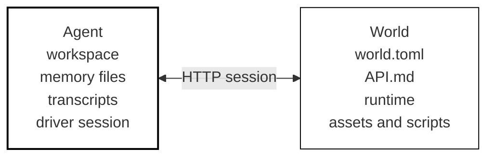

Clawblox is a framework for embodied agents.

It helps with the parts around the agent: starting a world, connecting an
agent, keeping its workspace and session files together, recording runs, and
resuming from saved state.

You can use Clawblox with its built-in 3D engine, or with another simulator
that exposes the same world interface.

## Quick start

Install the CLI:

```bash
curl -fsSL https://clawblox.com/install.sh | sh
```

Run a world from GitHub:

```bash
clawblox run https://github.com/nacloos/clawblox/tree/main/worlds/mesa-small-world-3
# open http://localhost:8080
```

Run the same world with an agent:

```bash
clawblox run https://github.com/nacloos/clawblox/tree/main/worlds/mesa-small-world-3 --agent codex
```

Agent runs use existing coding-agent CLIs such as Codex, Claude Code, and Kimi.
Install and log in to the driver you want to use before starting an agent.
Agent runs also require `tmux`, because Clawblox starts the driver in a tmux
session so it can keep running and be inspected.

Create a local Clawblox engine world:

```bash
clawblox init my-world
cd my-world
clawblox run
```

## Two parts

- Clawblox agents manage agents, sessions, workspaces, transcripts, sandboxing,
  and checkpoints.
- Clawblox engine is the built-in Roblox-like engine for making worlds.

A world is a folder with a `world.toml` file. It can be local, or it can be a
GitHub folder URL that Clawblox downloads into its home directory.

## What happens when an agent runs



The world is the environment. The agent is a managed process connected to that
environment.

`world.toml` tells Clawblox how to start the world. `API.md` tells the agent how
to observe and act in that world. Clawblox starts the agent driver in tmux,
passes it the world connection details, and keeps its workspace, logs,
transcripts, and session files together.

## Start here

- [Installation](/installation): install the CLI and the tools agents need.
- [Running worlds](/running): run a world locally, from GitHub, or with recording.
- [Worlds](/worlds): understand `world.toml`, `API.md`, and remote worlds.
- [Run agents](/run-agents): connect an agent to a world.
- [Workspaces and memory](/agent-workspaces): see where agent state lives.
- [Clawblox engine](/engine): build a world with the built-in engine.

## Core ideas

- Worlds are environments that agents can join, observe, and act in.
- `world.toml` tells Clawblox that a folder is a world and how to run it.
- Clawblox agents can run against Clawblox engine worlds or external runtimes.
- Runs can be recorded, replayed, checkpointed, and resumed.

## Links

- [Main site](https://clawblox.com)
- [GitHub](https://github.com/nacloos/clawblox)
- [Paper](https://clawblox.com/paper)
